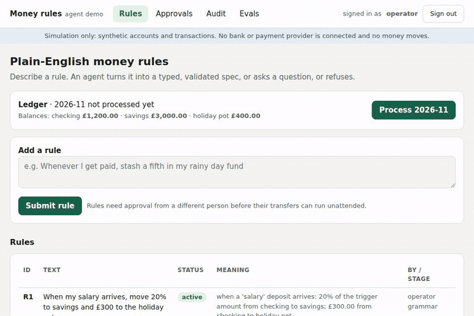
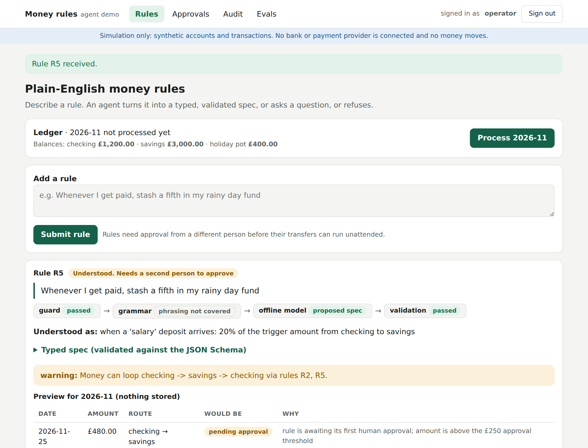
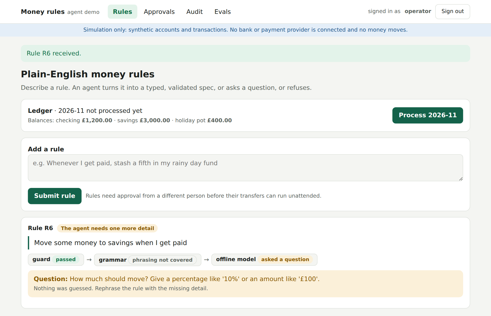
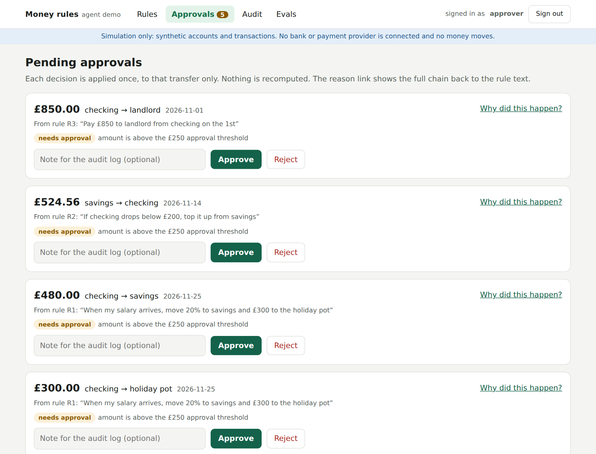
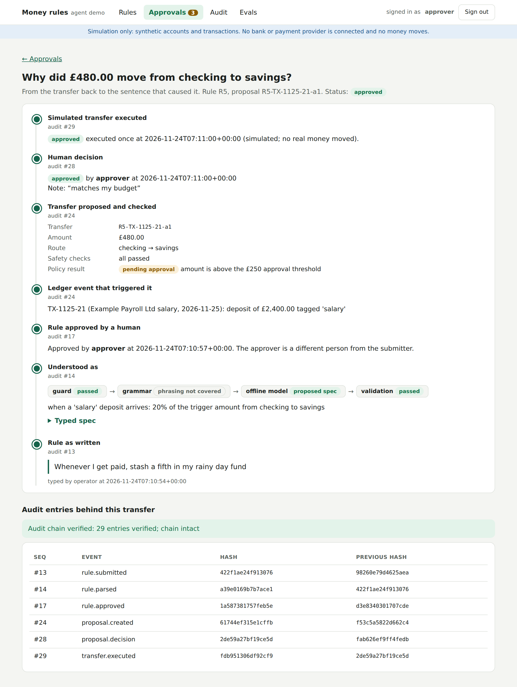
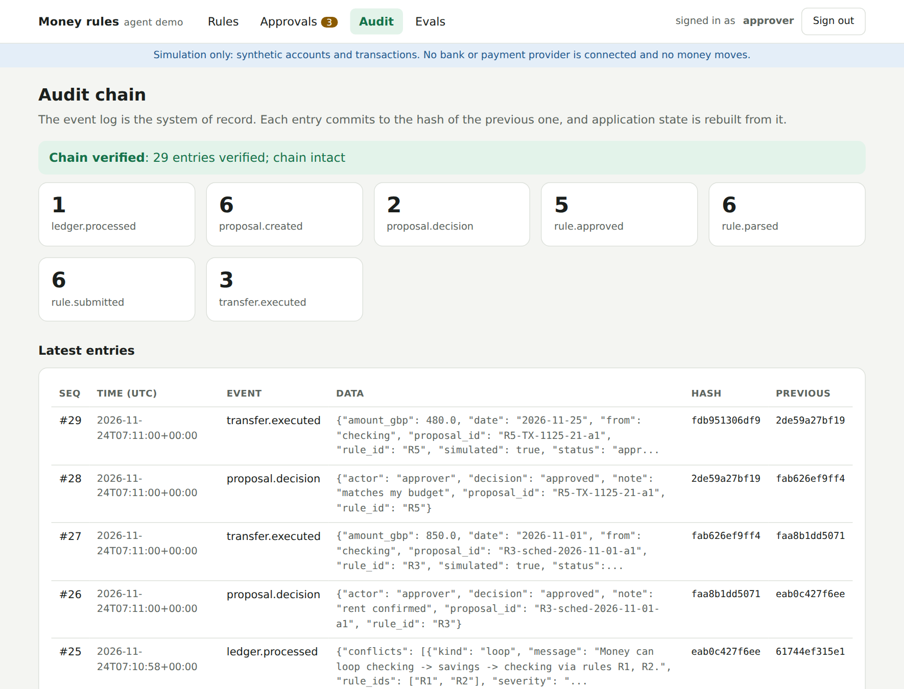
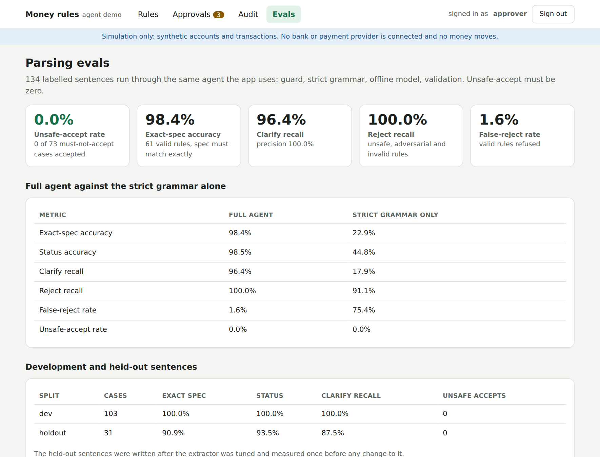
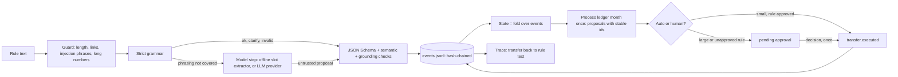

# Money rules agent (simulation prototype)



*About 24 seconds in the real web UI: type a rule, see how the agent read it, approve it as a second person, process the ledger month, approve one transfer, then open its "why did this happen" trace. ([MP4 version](docs/demo.mp4))*

Plain-English money-routing rules are turned into strictly typed rule specs by a small agent (guard, strict grammar, model step, validation), simulated over a synthetic ledger, held for a human decision where policy requires it, and recorded in a hash-chained event log. The log is the system of record: application state is a fold over it, every decision is applied exactly once, and any transfer can be traced back to the sentence that caused it.

> **Simulation only.** All accounts, transactions and transfers are fictional. Nothing connects to a bank or payment provider, and no money moves. "Executed" means a simulated state change in a local event log.

## Problem

Users want rules such as "when my salary arrives, move 20% to savings" or "if checking drops below £200, top it up from savings". Those rules touch money, so the system must:

- never guess an amount, account or schedule (it asks instead) and never accept "move everything",
- treat model output as untrusted: schema, semantic and grounding checks before anything is stored,
- stop transfers that would overdraw an account, exceed a limit, or loop money between accounts,
- require a human decision for large amounts and for rules nobody has approved, with separation of duties,
- keep a record that ties every transfer back to the exact rule text and the people who approved it.

## Screenshots

| | |
| --- | --- |
|  |  |
| 1. A paraphrase is parsed into a typed spec; the chips show which stage produced it, plus a no-side-effect preview. | 2. A vague rule gets a question instead of a guess. |
|  |  |
| 3. Pending approvals, each linked to its trace. | 4. "Why did this happen": from the executed transfer back to the typed rule text. |
|  |  |
| 5. Hash chain verified, with event counts. | 6. Eval results rendered from the real run. |

## Architecture



| Module | Role |
| --- | --- |
| `agent.py` | Pipeline and trace: guard, grammar, model proposal, validation, grounding, optional LLM/offline agreement check. |
| `parser.py` | Strict grammar for the documented phrasings. |
| `offline_model.py` | Deterministic intent/slot extractor behind the provider interface: normalises amounts, fractions, ordinals and account synonyms, locates one trigger, fills slots per clause, fails closed on leftover words. No API key needed. |
| `llm.py` | Provider interface (`propose(text) -> spec \| clarify \| reject`) and an OpenAI-compatible provider configured from environment variables. |
| `schema.py` | JSON Schema 2020-12 for rule specs plus semantic checks. |
| `engine.py` | Walks a ledger month once and returns events; proposal ids are `<rule>-<ledger event>-a<n>`. |
| `projection.py` | Pure, idempotent fold from events to state. |
| `service.py` | Commands (submit, approve rule, process, decide) and the trace. Idempotent; four-eyes on rule approval. |
| `safety.py` | Over-allocation and loop detection, overdraft, per-transfer limit, approval policy. |
| `audit.py` | Append-only hash-chained JSON Lines with a file lock. |
| `evals.py`, `evals/rule_cases.json` | Labelled sentences and metrics. |
| `auth.py`, `web.py` | Local demo users, sessions, CSRF, and the web UI (stdlib only). |

### Agent design

1. **Guard.** Rejects empty or over-long text, control characters, links, credential-like words, instructions aimed at the assistant, and long digit strings (account or card numbers).
2. **Strict grammar.** The original deterministic parser handles canonical phrasings and returns a spec, a question, or a final rejection (for example percentages above 100%).
3. **Model step.** Only for phrasing the grammar does not cover. The default is the offline extractor; set the `RULES_LLM_*` variables to use a real provider instead. The model returns `{"spec"}`, `{"clarify"}` or `{"reject"}`.
4. **Validation.** Whatever the model proposes must pass JSON Schema, semantic checks, and a grounding check (every number in the spec must appear in the rule text, so an invented amount is rejected).
5. **Agreement check (LLM path).** If an LLM and the offline extractor both return specs and they differ, the user is asked to rephrase rather than one being picked.

Every stage is recorded in a trace stored with the rule, so reviewers see which stage produced the spec.

### Event-sourced execution

- All state changes are events in the hash-chained log; state is rebuilt by folding it. A new process sees exactly the same state.
- Processing a ledger month once emits `proposal.created` events with stable ids; processing it again creates nothing.
- A human decision is one `proposal.decision` event. Repeating the same decision is a no-op, the opposite decision is refused (decisions are final), and approval executes only that proposal, once, after re-checking balances (it is blocked if the account no longer has the money). Nothing else is recomputed, withdrawn or re-proposed.
- Rules are approved by a different person from the submitter. Conflicting rules cannot be approved.

## Supported phrasing

The strict grammar accepts, for example:

```
When my salary arrives, move 20% to savings and £300 to the holiday pot
If checking drops below £200, top it up from savings
Pay £850 to landlord from checking on the 1st
```

The offline extractor additionally handles paraphrases such as:

```
Whenever I get paid, stash a fifth in my rainy day fund
if my current account falls under 150 quid then top it up from savings
every month on the fifteenth send £850 to landlord from checking
when salary lands, put 10% into savings and £50 towards holiday
```

Accounts are `checking`, `savings` and `holiday pot` (with synonyms). Anything else becomes a payee only for `pay`/`send`, never for moves. Days are 1 to 28.

## How to run

Requirements: Python 3.10 or newer. Nothing else is needed for the default offline mode.

```sh
scripts/test.sh                                   # creates .venv on first run, runs pytest
.venv/bin/python -m rules_agent demo              # load examples, approve, process the month
.venv/bin/python -m rules_agent parse "Whenever I get paid, stash a fifth in my rainy day fund"
.venv/bin/python -m rules_agent proposals
.venv/bin/python -m rules_agent approve <id> --note "..."    # applied once
.venv/bin/python -m rules_agent explain <id>      # trace a transfer back to the rule text
.venv/bin/python -m rules_agent verify            # check the audit hash chain
.venv/bin/python -m rules_agent eval --html evals.html
.venv/bin/python -m rules_agent web --port 8765   # log in at http://localhost:8765/
.venv/bin/python -m rules_agent reset
```

The web server generates two demo users (`operator`, who submits rules and processes the ledger, and `approver`, who approves rules and transfers) on first start. Their generated passphrases are written to `data/demo_logins.txt`, which is git-ignored; nothing is committed. Sessions use an HttpOnly, SameSite=Strict cookie that is rotated on login. Every POST needs a per-session CSRF token and a same-origin `Origin`; the `Host` header must be `localhost`; failed logins are throttled.

Optional LLM backend (no key is stored in the repository):

```sh
export RULES_LLM_PROVIDER=openai_compatible
export RULES_LLM_BASE_URL=https://<your-provider>/v1
export RULES_LLM_KEY=<from your credential manager>
export RULES_LLM_MODEL=<model-id>
```

To regenerate the images: `.venv/bin/pip install -r requirements-dev.txt`, then `scripts/screenshots.py` and `scripts/record_demo.py` (headless Chrome, driving the real UI; ffmpeg comes from `imageio-ffmpeg`).

## Evals

`python -m rules_agent eval` runs 134 labelled sentences (61 should parse to an exact spec, 28 need a clarifying question, 45 must be rejected: unsafe, adversarial or invalid) plus 6 two-rule conflict scenarios. Real numbers from the run in this repository:

| Metric | Full agent | Strict grammar only |
| --- | --- | --- |
| Exact-spec accuracy (61 valid rules) | 98.4% (60/61) | 22.9% |
| Status accuracy (all 134) | 98.5% | 44.8% |
| Clarify recall (28) / precision | 96.4% / 100% | 17.9% / 50.0% |
| Reject recall (45) | 100% | 91.1% |
| False-reject rate (valid rules refused) | 1.6% | 75.4% |
| **Unsafe-accept rate (73 must-not-accept cases)** | **0%** | 0% |
| Conflict detection (6 scenarios) | 6/6 | n/a |

Honest reading of these numbers:

- The set was written alongside the extractor and tuned to 103/103 on the 103 development sentences. The 31 sentences in the `holdout` split were written afterwards and measured once before any change: **exact-spec 90.9% (10/11), status 93.5% (29/31), clarify recall 87.5% (7/8), 0 unsafe accepts**. That is the better estimate of how it generalises, from a small sample.
- The two held-out misses are safe: a valid rule refused ("..., split: 10% to savings and 10% to the holiday fund", because "split" is not understood) and a vague payee rule that was rejected instead of clarified.
- The unsafe-accept test is enforced by the test suite, so a change that lets any unsafe or adversarial sentence through fails CI.
- The LLM path is covered by fake-transport tests only; there is no measured accuracy for a real model.

## Tests

`scripts/test.sh` runs `pytest -q`: 74 tests, all passing.

- `test_parser.py`, `test_schema.py`, `test_safety.py`: grammar, schema and semantic checks, conflicts, limits.
- `test_agent.py`: guard, paraphrases, fail-closed behaviour, trace, LLM path (grounding, validation, fallback, disagreement) with a fake transport.
- `test_evals.py`: set size and shape, zero unsafe accepts, quality floors, held-out floor.
- `test_audit.py`: hash chain, idempotent processing, stable ids, approvals applied once without re-running the month, final decisions, replay equals live state, four-eyes, execution-time balance check, preview stores nothing, trace.
- `test_web.py`: a real server on localhost: login and lockout, role separation, CSRF and origin checks, host check, escaping, double-submit approval, trace and audit pages.

## Limitations

- **Simulation only.** No bank, payment or open-banking integration. The ledger is synthetic and generated month by month in one currency (GBP).
- **The model step is still a rule-based stand-in.** The offline extractor covers many paraphrases but not free-form language; unfamiliar phrasing is refused or questioned, not understood. A real LLM provider is implemented and validated, but only tested with a fake transport.
- **Small eval set.** 134 sentences written by one author; the held-out split has 31.
- **Pending proposals do not move projected balances.** Each proposal is checked against balances when it is created and again when it is approved; a month with many pending items can look different once they are all approved.
- **Rules apply from the moment a ledger month is processed.** A rule added after a month was processed does not backfill it (the preview shows what it would have done); it applies to the next month.
- **Demo-grade web security.** Local users and in-memory sessions, localhost only; not a production auth system.
- **Tamper evidence, not tamper proofing.** The hash chain shows edits, but whoever controls the file can rewrite the whole chain; anchoring the head hash elsewhere would be needed.
