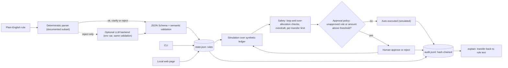

# Money rules agent (simulation prototype)

Plain-English money-routing rules are turned into strictly typed rule specs, validated against a JSON Schema, simulated over a synthetic ledger, held for human approval where required, and recorded in an append-only audit log that can explain why any transfer happened.

> **Simulation only.** All accounts, transactions and transfers are fictional. Nothing connects to a bank or payment provider, and no money moves. "Executed" means a simulated state change in a local file.

## Problem

Users want rules such as "when my salary arrives, move 20% to savings" or "if checking drops below £200, top it up from savings". Those rules touch real money, so the system must:

- never guess an amount, account or schedule (it asks instead),
- reject rules that cannot be made precise,
- stop transfers that would overdraw an account, exceed a limit, or loop money between accounts,
- require a human decision for large amounts and for rules nobody has approved yet,
- keep a record that ties every transfer back to the exact rule text that caused it.

## Architecture



### Components

| Module | Role |
| --- | --- |
| `rules_agent/parser.py` | Deterministic parser for the documented phrasing subset. Returns `ok`, `clarify` (with a question) or `reject` (with reasons). |
| `rules_agent/schema.py` | `RULE_SPEC_SCHEMA` (JSON Schema 2020-12) plus semantic checks such as percentages summing to at most 100 and top-ups targeting their trigger account. |
| `rules_agent/llm.py` | Optional OpenAI-compatible provider behind a small interface. Used only when the deterministic parser rejects a rule, and its output must pass the same validation. |
| `rules_agent/ledger.py` | Seeded synthetic ledger: three fictional accounts and one month of fake transactions. |
| `rules_agent/engine.py` | Simulation: fires triggers (deposit, balance below, monthly), computes amounts, applies safety checks, and sorts proposals into auto, pending or blocked. |
| `rules_agent/safety.py` | Static conflict detection (over-allocation, account loops) and runtime checks (overdraft, per-transfer limit, approval policy). |
| `rules_agent/audit.py` | Append-only JSON Lines log. Each entry stores the hash of the previous entry, so edits are detectable with `verify`. |
| `rules_agent/service.py` | Workflow layer used by the CLI and the web page. Every state change is audited; `explain` builds the trace. |
| `rules_agent/cli.py`, `rules_agent/web.py` | Command line and a stdlib-only local web page (rules, proposals awaiting approval, conflicts, audit trail). |

## Supported rule phrasing

```
When my <tag> arrives, <actions>            e.g. "When my salary arrives, ..."
If [my] <account> drops below £<amount>, <actions>
On the <day>st, <actions>                   or: <actions> on the 1st
```

Actions, joined with `and` or `;`:

- `move <n>% [from <account>] to <account>`
- `move £<amount> [from <account>] to <account>`
- `top it up from <account>` (only after an "drops below" trigger)
- `pay £<amount> [to] <payee> from <account>`

Accounts: `checking`, `savings`, `holiday pot`. A deposit lands in `checking`, which is the default source for `move` actions. Days must be 1 to 28.

Outcomes:

- **ok**: a typed spec is stored as `pending_review`.
- **clarify**: a question is returned, for example `Pay rent on the 1st` asks for the amount and source account.
- **reject**: reasons are returned, for example an unknown account, percentages above 100%, or no trigger.

## How to run

Requirements: Python 3.10 or newer. Nothing else is needed for the default offline mode.

```sh
scripts/test.sh                                  # creates .venv on first run, runs pytest

.venv/bin/python -m rules_agent demo             # load examples/rules.txt, approve, simulate
.venv/bin/python -m rules_agent proposals
.venv/bin/python -m rules_agent approve <id>     # or: reject <id> --note "..."
.venv/bin/python -m rules_agent run              # re-simulate after decisions
.venv/bin/python -m rules_agent explain <id>     # trace a transfer back to the rule text
.venv/bin/python -m rules_agent verify           # check the audit hash chain
.venv/bin/python -m rules_agent web --port 8765  # http://localhost:8765/
.venv/bin/python -m rules_agent reset            # clear local state (data/ is gitignored)
```

Optional LLM backend (no key is stored in the repository):

```sh
export RULES_LLM_PROVIDER=openai_compatible
export RULES_LLM_BASE_URL=https://<your-provider>/v1
export RULES_LLM_KEY=<from your credential manager>
export RULES_LLM_MODEL=<model-id>
```

## Example session

Output below was produced by running the commands in this repository (trimmed).

```text
$ python -m rules_agent demo
R1 [pending_review] When my salary arrives, move 20% to savings and £300 to the holiday pot
R2 [pending_review] If checking drops below £200, top it up from savings
R3 [pending_review] Pay £850 to landlord from checking on the 1st
Proposals by status: {'pending_approval': 4}
R3-sched-2026-11-01-a1  pending_approval    £850.00  checking -> landlord  2026-11-01
      amount is above the £250 approval threshold
R2-TX-1114-15-a1  pending_approval    £484.56  savings -> checking  2026-11-14
      amount is above the £250 approval threshold
R1-TX-1125-21-a1  pending_approval    £480.00  checking -> savings  2026-11-25
      amount is above the £250 approval threshold
R1-TX-1125-21-a2  pending_approval    £300.00  checking -> holiday pot  2026-11-25
      amount is above the £250 approval threshold

$ python -m rules_agent approve R3-sched-2026-11-01-a1 --note "rent confirmed"
R3-sched-2026-11-01-a1 approved; simulation re-run.
$ python -m rules_agent approve R1-TX-1125-21-a1 --note "matches budget"
$ python -m rules_agent approve R1-TX-1125-21-a2 --note "matches budget"
$ python -m rules_agent run
Proposals by status: {'approved': 3, 'auto_executed': 1}
[warning] Money can loop checking -> savings -> checking via rules R1, R2.
R2-TX-1103-04-a1  auto_executed        £56.39  savings -> checking  2026-11-03
      within approval threshold and rule already approved
Projected end-of-month balances: checking £473.35, savings £3,423.61, holiday pot £700.00

$ python -m rules_agent explain R1-TX-1125-21-a1
Transfer R1-TX-1125-21-a1: £480.00 from checking to savings on 2026-11-25
Status: approved (simulated, no real money moves)
Caused by rule R1: "When my salary arrives, move 20% to savings and £300 to the holiday pot"
  Parsed as: when a 'salary' deposit arrives: 20% of the trigger amount from checking to savings; £300.00 from checking to holiday pot
  Rule source: deterministic; status: active (approved by demo-operator)
Trigger event: TX-1125-21 (Example Payroll Ltd salary, 2026-11-25): deposit of £2,400.00 tagged 'salary'
Reasons: approved by cli
Safety checks: passed
Human decision: approved by cli at 2026-11-24T06:13:06+00:00 (matches budget)
Audit trail:
  #1   rule.submitted     hash 1ed695a3aa02
  #2   rule.parsed        hash 5a993356d7b0
  #7   rule.approved      hash c11defa86e80
  #11  proposal.created   hash ffff4d4f9dfb
  #25  proposal.decision  hash e45255cd7367
  #27  proposal.status    hash 7ccc0553a30d
  #28  transfer.executed  hash 136c3789a903

$ python -m rules_agent verify
33 entries verified; chain intact
```

Rejections and clarifications, from the same CLI (rule IDs continue from the existing data directory):

```text
$ python -m rules_agent add "Pay rent on the 1st"
R6 [invalid] Pay rent on the 1st
    clarify: Pay how much, and from which account? For example 'pay £850 to landlord from checking'.
$ python -m rules_agent add "When my salary arrives, move 70% to savings and 40% to holiday pot"
    rejected: percentages in this rule add up to 110% (maximum is 100%)
$ python -m rules_agent add "If checking drops below £200, top it up from current"
    rejected: Unknown account 'current'. Known accounts: checking, savings, holiday pot.
$ python -m rules_agent add "Move some money to savings when I get paid"
    rejected: No trigger found. Start the rule with 'When my <tag> arrives,' or ...
```

Note that approving the rent changed the balance path, so the top-up that was first proposed for 14 November was withdrawn and replaced by a 3 November top-up of £56.39. The audit log records this as a `proposal.withdrawn` event. Decisions are per proposal ID, and every run recomputes the month from the rules and the decisions so far.

## Safety checks

| Check | Where | Effect |
| --- | --- | --- |
| Schema and semantic validation | `schema.py` | Invalid specs are rejected with paths and messages. |
| Percentages in one rule above 100% | `schema.py` | Rejected. |
| Percentages on the same deposit source above 100% across rules | `safety.py` | Error: all involved rules are blocked. |
| Money loops between internal accounts | `safety.py` | Error if the cycle is made only of balance top-ups (unbounded ping-pong). Warning otherwise. |
| Overdraft (projected balance below minimum) | `safety.py` | Proposal blocked. |
| Amount above per-transfer limit (£1,000) | `safety.py` | Proposal blocked. |
| Amount above approval threshold (£250) or rule not yet approved | `safety.py` | Proposal waits for a human decision. |
| Balance triggers fire once per crossing | `engine.py` | Edge-triggered, so a balance that stays low does not re-fire. |

## Test results

Command: `scripts/test.sh` (runs `pytest -q`).

```text
......................................                                   [100%]
38 passed in 0.24s
```

Coverage by file:

- `tests/test_parser.py` (11 tests): valid phrasings produce exact specs, ambiguous rules get a question, unknown accounts, percentages above 100%, day range, top-up without a balance trigger, and empty input are rejected.
- `tests/test_schema.py` (14 tests): schema bounds and unknown keys, semantic rules, LLM output that passes or fails validation, clarify pass-through, non-JSON output, provider configuration from the environment. The LLM tests use a fake transport, not a live provider.
- `tests/test_safety.py` (7 tests): over-allocation, ping-pong loops as errors, loops through deposit rules as warnings, overdraft, per-transfer limit, approval policy.
- `tests/test_audit.py` (6 tests): hash chain verification and tamper detection, logging of rule text and parsed spec, pending approval for unapproved rules, `explain` tracing, approve and reject flows, determinism of the simulation.

The web page was smoke-tested on localhost: the page returns 200, rule submission redirects, and invalid decisions return 400.

## Limitations

- **Simulation only.** No bank, payment or open-banking integration. The ledger is synthetic and covers one month of one currency (GBP).
- **Narrow grammar.** The deterministic parser handles the documented phrasings only. Anything else is rejected or answered with a question. It does not understand relative dates, fees, time zones or settlement delays.
- **LLM backend is not evaluated.** It is implemented behind an interface and its output is validated, but it has only been tested with a fake transport. No accuracy measurement exists.
- **Approvals are a re-simulation.** A decision re-runs the whole month, so downstream proposals can change or disappear. Withdrawn proposals are logged, but the operator may need to review them again.
- **Balance triggers are evaluated once per ledger event.** Cascades from transfers that a balance rule itself applies are not re-evaluated within the same event.
- **Loop detection is account-level.** It finds cycles among the three internal accounts, not every possible interaction.
- **Local, single-user storage.** State is a JSON file and the web page has no authentication or CSRF protection. It binds to localhost only. Approver names are free text, not verified identities.
- **Tamper evidence, not tamper proofing.** The hash chain shows edits made to the file, but whoever controls the file can rewrite the whole chain. Anchoring the head hash elsewhere would be needed for a stronger guarantee.

## Next steps

- Build a labelled set of rule phrasings (accepted, clarified, rejected) and measure the deterministic parser and any LLM provider against it.
- Replace the whole-month re-run with per-proposal recomputation, or freeze approved proposals and show their downstream impact before approval.
- Add a time model (pay dates, settlement lag) and a longer simulation window.
- Move storage to SQLite with proper locking, and add authentication for the web page.
- Sign audit entries or anchor the chain head outside the file.
